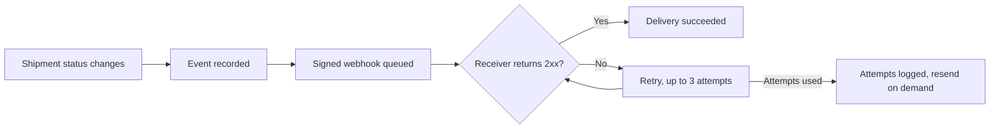
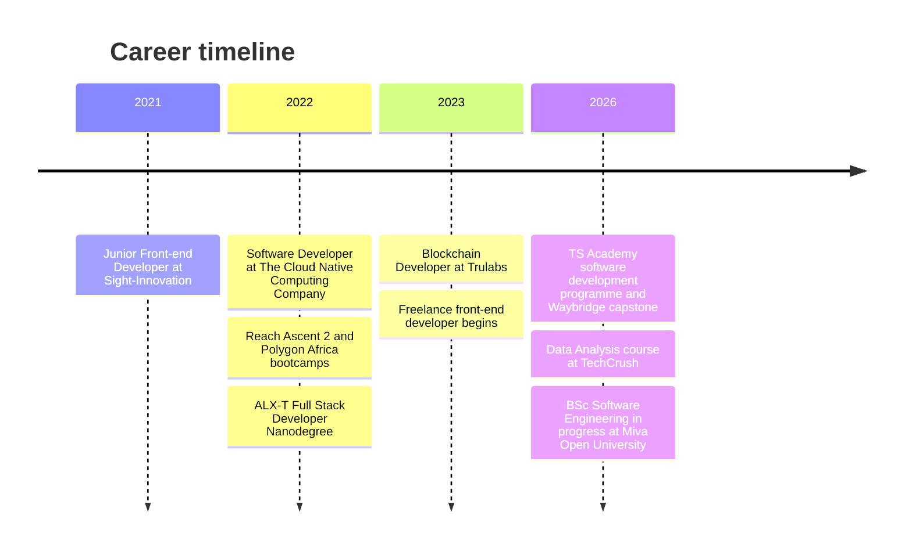

<div align="center">


<br />

[](https://linkedin.com/in/emmanuel-o-agbavwe)
[](mailto:emmagbavwe@gmail.com)
<!-- Add a Portfolio badge here once your portfolio site is live:
[](https://YOUR-PORTFOLIO-URL)
-->

<br />

<table>
  <tr>
    <td align="center" width="170"><h2>5+</h2>years in front-end development</td>
    <td align="center" width="170"><h2>10</h2>client projects delivered</td>
    <td align="center" width="170"><h2>5</h2>smart contracts written as sole blockchain developer</td>
    <td align="center" width="170"><h2>2</h2>clients who came back for more work</td>
  </tr>
</table>

</div>

---

## 🧭 About

I'm a front-end developer who turns Figma designs into accessible, consistent web interfaces with **React**, **Next.js** and **TypeScript**. I've worked across freelance, contract and remote team settings, and much of my client work is in **Web3**, mostly on **Algorand**. I build for the person using the product, for example by showing token details directly so nobody has to look up asset IDs on a block explorer.

I can also work below the interface. When a UI depends on a contract, I understand both sides:

| | |
|---|---|
| 🔗 **TruYou** (Trulabs) | Sole blockchain developer. Wrote 5 smart contracts from scratch on Algorand (in Reach), plus a JavaScript integration layer of 19 callable functions with WalletConnect support. |
| 🧪 **cometa-lm-contract** (The Cloud Native Computing Company) | Reverse-engineered an undocumented farming-pool contract, wrote an 11-case automated test suite for it, and built a demo dApp around the findings. |

---

## 🛠️ Tech I Work With

<div align="center">


<br /><br />


</div>

```text
Languages     TypeScript · JavaScript · HTML · CSS
Front-end     React · Next.js · Tailwind CSS · CSS Modules · PWA
Web3          Algorand · Reach · Smart Contract Testing · WalletConnect · Pera Wallet · Algorand Indexer · Thirdweb
Workflow      Git/GitHub · Figma · Firebase · Node.js · REST API Integration
```

---

## 🚀 Selected Work

> [!NOTE]
> Client project code is private. Live links are included wherever a project is public.

### 💼 Client Work

| Project | What it is | Access |
|---|---|---|
| **ViewReward** | Learn-to-earn platform on Algorand, with token details pulled from the Pera Public Asset Library and Algorand Indexer. | 🌐 [Live](https://viewreward.app) |
| **Redeemify** | Redeem physical items with NFTs. | 🌐 [Live](https://redeemify.app) |
| **Ghetto Market** | Marketplace platform with a multi-step NFT shuffle setup and search-and-preview. | 🌐 [Live](https://market.ghettopigeon.com) |
| **BigBallz** | Meme coin website, shipped as a PWA. Front-end team lead. | 🌐 [Live](https://ballz.ghettopigeon.com) |
| **Ghetto Pigeon Website** | Vercel redeployment. | 🌐 [Live](https://ghettopigeon.com) |
| **Pigeon Puffs** | Web3 game-portal platform. | 🌐 [Live](https://puffs.ghettopigeon.com) |
| **Ghetto Warzones** | Web3 platform. | 🌐 [Live](https://warzones.ghettopigeon.com) |
| **Crazy Embryo Club** | Web3 gamified community platform, with custom animations and a smart collection lookup. | 🌐 [Live](https://crazy-embryo-club-alpha.vercel.app) |
| **ChainBois** | NFT project website. Front-end team lead. | 🔒 Private |
| **ChainBois Token Page** | Token page. Front-end team lead. | 🔒 Private |

### 🎓 Programme Capstone

> Built with a team as my capstone submission for the **TS Academy** software development programme.

<table>
  <tr>
    <td>
      <h4>📦 Waybridge: Logistics Webhook Management Platform</h4>
      Track shipments end to end and notify downstream systems the moment a shipment's status changes.
      <br /><br />
      <a href="https://waybridge-six.vercel.app/"></a>
      <a href="https://github.com/TS-Academy-Webhooks"></a>
      <br /><br />
      
      
      
      
      
    </td>
  </tr>
</table>

<!-- Add one or two lines on the parts you personally built, for example:
**My contribution:** ...
-->

**What the platform does**

- 📦 Moves shipments through a validated lifecycle, with a full timeline history and a public tracking page that needs no account
- 🔔 Lets users subscribe endpoints to shipment events, with HMAC-SHA256 signed payloads
- 🔁 Retries failed deliveries (up to three attempts), keeps a complete attempt log, and supports on-demand resend
- 🔐 Separates customer and admin access, using short-lived access tokens with HttpOnly refresh sessions
- 📖 Documents the API in Swagger, covering 36 operations



### 🧑‍💻 Personal Projects

| Project | What it is | Access |
|---|---|---|
| `ATMachine` | Console-based ATM simulation (Java) | ✅ Public |
| `AroShop` | Console-based shopping app (Java) | ✅ Public |
| Inventory App | Stock management system (Python) | ✅ Public |

*A few other personal projects are pinned to my profile, while a few more are lurking somewhere in my repository list. Feel free to poke around.*

---

## 🗺️ Journey



---

## 📊 GitHub at a Glance

<div align="center">





</div>

---

## 💬 Let's Talk

Open to remote front-end roles, or onsite roles in Nigeria, and to Web3 collaboration. Open to relocating abroad with employer visa sponsorship. Ask me about turning Figma designs into React and Next.js interfaces, or about how a UI and a smart contract fit together. Happy to nerd out.

*Fun fact: I'm not a fan of enclosing curly braces.*


